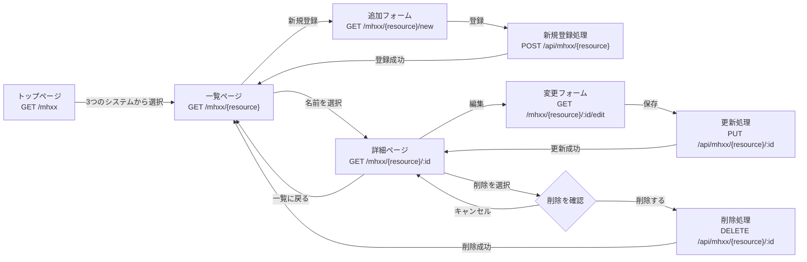

# モンスターハンターダブルクロス（MHXX）関連システム 設計仕様書

作成日：2026年11月13日。week9時点の設計を記載する。
この文書のMHXX関連機能は実装予定の仕様であり、実装済みの駅一覧・詳細表示・駅追加とは区別する。

ソースコード配置先：[webpro_06](https://github.com/kazu0502/webpro_06)。
この文書とweek9の変更は、GitHubへの反映前にローカルで確認する。

## 決定した方針

- 対象作品はモンスターハンターダブルクロス（MHXX）とする。
- モンスター図鑑・武器図鑑・クエスト管理の3つを作る。
- 武器図鑑は、武器の性能や必要素材を調べる用途とする。
- 武器の所持状況・作成状況は管理しない。
- クエスト管理は、クエスト情報に加えて自分のクリア状況も記録する。

## 1. 利用者向け

### 目的と対象

MHXXを遊ぶ利用者が、モンスターと武器の情報を確認し、自分のクエスト進捗を記録する。
1人で使う学習用アプリとして、3つのシステムを同じWebサーバーに実装する。

### 初期データ

#### モンスター

| 名前 | 種族 | 有効な属性の概要 | 生息地・出現場所 |
| --- | --- | --- | --- |
| ショウグンギザミ | 甲殻種 | 火・雷 | 沼地・火山・遺群嶺 |
| ザボアザギル | 両生種 | 火・雷 | 氷海 |

弱点属性は攻略上の概要として表示する。部位や状態ごとの肉質表は管理しない。
攻略メモは利用者が自由に入力する。

出典：[MHXX攻略データベース：ショウグンギザミ](https://x.mh4info.com/m/d/120)、[Game8：ザボアザギル](https://game8.jp/mh-xx/822671)（2026年11月13日確認）。

#### 武器

初期データには、以下の太刀2件を登録する。

| 武器名 | 武器種 | 攻撃力 | 属性 | 会心率 |
| --- | --- | --- | --- | --- |
| 真飛竜刀【双獄炎】（LV6） | 太刀 | 300 | 火44 | 10% |
| 鎧裂鎌ドヒキサキ（LV5） | 太刀 | 330 | 無属性 | 5% |

必要素材は、その武器への最後の強化で使う素材を記録する。
最初の生産から必要になる全素材の合計とは区別する。

- 真飛竜刀【双獄炎】：獰猛化雌火竜厚鱗×3、獰猛化火竜厚鱗×3、煌炎の雫×3、獰猛化狩猟の証Ⅵ×1。
- 鎧裂鎌ドヒキサキ：鎧裂狩猟の証5×1、鎧裂の剛爪×3、鎧裂の重龍頭殻×4、極上黒真珠×4。

会心率は、攻撃力や属性と併せて比較できるよう独立した項目として管理する。

出典：[Kiranico：飛竜刀【双炎】の派生・強化](https://mhxx.kiranico.com/buki/4609b)、[Game8：鎧裂鎌ドヒキサキ](https://game8.jp/mh-xx/824637)（2026年11月13日確認）。

#### クエスト

以下の3件を初期データとする。

| クエスト名 | 区分・難易度 | 達成条件 | 目的地 | メイン報酬金 |
| --- | --- | --- | --- | --- |
| ショウグンギザミを愛でたくて | 村★4 | ショウグンギザミ1匹の捕獲 | 火山 | 5,100z |
| ぷくぅーっ！ザボアザギル！ | 村★8 | ザボアザギル1頭の狩猟 | 氷海 | 4,500z |
| 熱愛発覚！？ 竜達の密会！ | 集会所★7 | ライゼクス1頭とリオレイア1頭の狩猟 | 遺跡平原 | 13,800z |

クリア状況の初期値は未クリアとする。これは利用開始時の初期値であり、利用者の実際の進捗を推定したものではない。
報酬はメイン報酬金を扱い、報酬素材やサブ報酬は初期の実装範囲に含めない。

出典：[Kiranico：ショウグンギザミを愛でたくて](https://mhxx.kiranico.com/quest/43e5b)、[Kiranico：ぷくぅーっ！ ザボアザギル！](https://mhxx.kiranico.com/quest/43a8d)、[Kiranico：熱愛発覚！？ 竜達の密会！](https://mhxx.kiranico.com/quest/9b653)（2026年11月13日確認）。

### モンスター図鑑

モンスターの一覧から名前を選び、弱点属性や攻略メモを確認する。

一覧に表示する項目：名前・種族・弱点属性。
詳細ページには、一覧の情報に加えて生息地・攻略メモを表示する。

### 武器図鑑

武器の一覧から名前を選び、性能や必要素材を確認する。

一覧に表示する項目：武器名・武器種・攻撃力・属性。
詳細ページには、一覧の情報に加えて会心率・必要素材・補足メモを表示する。
必要素材は、素材名と個数を文章で入力する。

### クエスト管理

クエストの一覧から名前を選び、内容と自分のクリア状況を確認・変更する。

一覧に表示する項目：クエスト名・区分・難易度・クリア状況。
詳細ページには、一覧の情報に加えて達成条件・対象モンスター・目的地・メイン報酬金を表示する。
クリア状況は「未クリア」「クリア済み」の2段階とする。
新規登録時は未クリアを初期値とし、変更フォームで切り替える。

### 共通の画面遷移

3つのシステムで同じ画面構成を使う。追加・変更フォームからは、保存せずに戻ることもできる。

| システム | 一覧のURL | 詳細のURL例 | 追加のURL | 変更のURL例 |
| --- | --- | --- | --- | --- |
| モンスター図鑑 | `/mhxx/monsters` | `/mhxx/monsters/1` | `/mhxx/monsters/new` | `/mhxx/monsters/1/edit` |
| 武器図鑑 | `/mhxx/weapons` | `/mhxx/weapons/1` | `/mhxx/weapons/new` | `/mhxx/weapons/1/edit` |
| クエスト管理 | `/mhxx/quests` | `/mhxx/quests/1` | `/mhxx/quests/new` | `/mhxx/quests/1/edit` |

トップページは`/mhxx`とする。URLは実装予定のものであり、week9時点ではアクセスできない。

### 操作時の動き

- 追加：必要な項目を入力して登録すると、一覧に新しいデータが表示される。
- 詳細：一覧の名前を選ぶと、そのデータの全項目が表示される。
- 変更：現在の内容が入力されたフォームを開き、保存すると詳細ページの表示が更新される。
- クエストの進捗変更：変更フォームで未クリア・クリア済みを選択して保存する。
- 削除：確認で承認したときだけ削除し、一覧に戻る。キャンセルした場合はデータを残す。
- 入力エラー：理由を画面に表示し、入力内容を保持して修正できるようにする。
- 対象がない場合：見つからない旨と一覧へ戻るリンクを表示する。
- データが0件の場合：未登録の案内と追加フォームへのリンクを表示する。

## 2. 管理者向け

- 登録情報を追加・変更・削除できるようにする。
- 3つのシステムのデータは、それぞれ別の配列で管理する。
- データはサーバーの変数内に保存し、再起動すると初期データに戻る。
- 利用者と管理者のログイン・権限分離は実装せず、ローカルで1人が利用する。
- 初期データは実装予定の`app_mhxx.js`内に定義する。追加・変更・削除とクエストの進捗は、起動中の変数にのみ反映する。

### week9で実装済みの練習用サーバー

`webpro_06`を作業ディレクトリとして、`node app5.js`で起動する。

| 機能 | アクセス先 |
| --- | --- |
| 駅一覧 | `http://localhost:8080/keiyo2` |
| 駅詳細の例 | `http://localhost:8080/keiyo2/0` |
| 駅追加フォーム | `http://localhost:8080/public/keiyo2_add.html` |

駅詳細の末尾の番号は配列の添字であり、MHXXの設計で使うIDとは異なる。
駅追加では6項目を受け取り、ID・乗降客数・距離を数値として保存する。
追加後は一覧へ移動し、重複IDや不正な数値は登録しない。

### MHXX関連システムの起動計画

以下はREST API実装後の予定であり、`app_mhxx.js`はweek9時点では未作成。

1. 作業ディレクトリを`webpro_06`にする。
2. 依存パッケージがない場合は`npm install`を実行する。
3. 同じ8080番ポートの練習用サーバーを停止する。
4. `node app_mhxx.js`で起動し、`http://localhost:8080/mhxx`を開く。
5. 終了時はサーバーを実行しているターミナルで`Ctrl+C`を押す。

初期状態に戻す場合はサーバーを再起動する。再起動前の登録内容や進捗を復元する機能は設けない。
`npm start`は現在の`package.json`では`app4.js`を起動するため、上記のファイル名を指定して起動する。

## 3. 開発者向け

### データ構造

各データに数値型の`id`を付ける。詳細表示・変更・削除にはこのIDを使う。
IDはサーバーがシステムごとの連番として発行し、利用者は入力・変更しない。
削除時にほかのデータのIDは変更せず、起動中は削除済みのIDを再利用しない。

#### モンスター：`monsters`

| 項目名 | 型 | 内容 |
| --- | --- | --- |
| id | 数値 | モンスターID |
| name | 文字列 | モンスター名 |
| species | 文字列 | 種族 |
| weakness | 文字列 | 弱点属性 |
| habitat | 文字列 | 生息地 |
| notes | 文字列 | 攻略メモ |

#### 武器：`weapons`

| 項目名 | 型 | 内容 |
| --- | --- | --- |
| id | 数値 | 武器ID |
| name | 文字列 | 武器名 |
| type | 文字列 | 武器種 |
| attack | 数値 | ゲーム内に表示される攻撃力 |
| affinity | 数値 | 会心率（%）。-100以上100以下の整数 |
| element | 文字列 | 属性と属性値。無属性の場合も文字列で記録 |
| materials | 文字列 | 最後の強化で使う素材の名前と個数 |
| notes | 文字列 | 性能や生産・強化条件に関する補足 |

#### クエスト：`quests`

| 項目名 | 型 | 内容 |
| --- | --- | --- |
| id | 数値 | クエストID |
| name | 文字列 | クエスト名 |
| category | 文字列 | クエストの区分 |
| difficulty | 文字列 | 難易度 |
| objective | 文字列 | 達成条件 |
| target | 文字列 | 対象モンスター。複数の場合は「ライゼクス、リオレイア」のように記録し、対象がない場合は空欄 |
| location | 文字列 | 目的地 |
| rewards | 文字列 | メイン報酬金。例：13,800z |
| completed | 真偽値 | クリア状況。`false`は未クリア、`true`はクリア済み |

`completed`の初期値は`false`とする。
画面には真偽値の代わりに「未クリア」「クリア済み」を表示する。

### REST APIの設計

以下の`{resource}`には、`monsters`・`weapons`・`quests`のいずれかが入る。
画面用URLと区別するため、APIのURLは`/api/mhxx`から始める。

| HTTPメソッド | URL | 処理 | 成功時 |
| --- | --- | --- | --- |
| GET | `/api/mhxx/{resource}` | 全データを取得 | 200・`{data: [...]}` |
| GET | `/api/mhxx/{resource}/:id` | IDを指定して1件取得 | 200・`{data: {...}}` |
| POST | `/api/mhxx/{resource}` | 新規登録 | 201・`{data: {...}}` |
| PUT | `/api/mhxx/{resource}/:id` | 指定データを全項目更新 | 200・`{data: {...}}` |
| DELETE | `/api/mhxx/{resource}/:id` | 指定データを削除 | 204・本文なし |

例えば、クエストIDが3のクリア状況を変更する場合、`PUT /api/mhxx/quests/3`に変更後のクエスト情報全体を送る。
その際、`completed`だけを切り替え、クエスト名や達成条件は保持する。

### 入出力と入力チェック

- 入力は既存の演習と同じ`application/x-www-form-urlencoded`形式で送り、Expressの`express.urlencoded`で受け取る。
- 出力はJSON形式とし、ブラウザー側の`fetch`でAPIを呼び出す。
- POST・PUTでは、スキーマのうち`id`以外の項目を送る。IDはURLまたはサーバー側で決める。
- POST時の`completed`は省略可能で、初期値を`false`とする。PUT時は現在の値を含めて送る。
- `notes`と`target`は空欄を許可する。それ以外の文字列項目は空欄・空白のみを許可しない。
- `attack`は0以上の整数、`affinity`は-100以上100以下の整数に変換・検証する。空欄は0に変換せずエラーにする。
- `completed`は文字列の`"true"`または`"false"`だけを受け取り、真偽値へ変換する。
- 不正な入力には400、見つからないIDには404と、理由を示す`{error: "メッセージ"}`を返す。
- 存在するデータは配列の添字ではなく`id`が一致する要素として検索する。
- 不正な入力や見つからないIDで配列の内容を変更しない。
- 利用者の入力はテキストとして画面に表示し、HTMLとして解釈させない。

### 実装方針

- Node.jsとExpressを使用する。
- REST APIで一覧取得・詳細取得・追加・変更・削除を扱う。
- HTML・CSS・ブラウザー側のJavaScriptとEJSを使い、3つのシステムで共通の画面構成を用意する。
- JavaScriptファイルの先頭に`"use strict";`を記載する。
- 既存の練習用モンスター管理を参考にする。今回作る3つの機能は、練習用の機能と区別できるようにする。
- 画像、システム間のデータ連携、検索機能は現時点では必須機能に含めない。
- 初期データは本書に示した出典で確認した値を使い、出典リンクを仕様書に残す。

### 使用技術の概要と採用理由

ExpressはURLとHTTPメソッドごとの処理を定義するために使う。
EJSは一覧・詳細・フォームのHTMLを共通の形式で生成するために使う。
`fetch`は画面からAPIを呼び出すために使い、JSONはその応答データを表現するために使う。
これらは既存の演習ファイルを参考にし、追加のフレームワークやデータベースは導入しない。
REST APIは一覧・詳細・登録・変更・削除をHTTPメソッドとURLで整理する設計として採用し、授業の説明に合わせて実装を進める。

### 実装後の確認項目

1. 3つのシステムで、一覧から各データの詳細を開ける。
2. 追加したデータが一覧と詳細に反映される。
3. 変更した内容が保存され、ほかのデータは変わらない。
4. クエストのクリア状況を両方向に切り替えられる。
5. 削除をキャンセルした場合はデータが残り、承認した場合は一覧から消える。
6. 削除後も、残ったデータを同じIDで取得できる。
7. 必須項目の空欄、不正な数値、存在しないIDを扱ってもサーバーが停止しない。
8. 全件削除したときに未登録の案内が表示される。
9. 再起動すると初期のモンスター2件・武器2件・クエスト3件に戻る。
